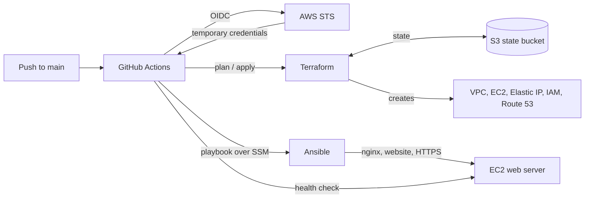

# AWS Terraform Ansible Deployment Automation

Provisions AWS infrastructure with Terraform, configures the server and deploys a website with Ansible, and checks it is healthy. GitHub Actions runs everything, logging in to AWS with OIDC instead of access keys.

| Environment | Website |
|---|---|
| dev | https://agex-dev.localhostshinn.xyz |
| prod | https://agex.localhostshinn.xyz |

## How It Works



1. A push to `main` starts the workflow.
2. GitHub Actions gets temporary AWS credentials through OIDC.
3. Terraform creates or updates the environment.
4. Ansible connects over AWS Systems Manager (no SSH), installs nginx, copies the website and sets up HTTPS with Let's Encrypt.
5. A health check confirms the site responds over HTTPS.

## Stages

| Stage | Folder | Tool | Docs |
|---|---|---|---|
| 01 State bucket | `bootstrap/01-state-bucket/` | AWS CLI | [README](bootstrap/01-state-bucket/README.md) |
| 02 GitHub OIDC | `bootstrap/02-github-oidc/` | Terraform, local state | [README](bootstrap/02-github-oidc/README.md) |
| 03 Infrastructure | `infrastructure/` | Terraform, S3 backend | [README](infrastructure/README.md) |
| 04 Configuration and deployment | `configuration/`, `application/` | Ansible | [README](configuration/README.md), [website](application/README.md) |
| 05 Verification | `scripts/` | Bash | [README](scripts/README.md) |
| CI/CD | `.github/workflows/` | GitHub Actions | [README](.github/workflows/README.md) |

## Project Structure

```text
.
├── bootstrap/
│   ├── 01-state-bucket/      S3 bucket for Terraform state
│   └── 02-github-oidc/       OIDC provider, CI role and policies
├── infrastructure/
│   ├── modules/              vpc, security-group, iam, ec2, s3, route53
│   └── environments/         dev, prod (Terraform runs here)
├── configuration/            Ansible inventory, playbook, webserver role
├── application/website/      static website
├── scripts/                  health check, identity check
├── .github/workflows/        deploy.yaml and the stage workflows
└── .env.example              template for local values
```

## Getting Started

You need the AWS CLI, Terraform 1.10 or newer, Python 3.13 or newer, and the GitHub CLI.

1. **Local values.** Copy the template and fill it in. The comments in the file show how to look up each value.
   ```bash
   cp .env.example .env
   set -a && source .env && set +a
   ```
2. **State bucket.** Run [`create-state-bucket.sh`](bootstrap/01-state-bucket/README.md).
3. **OIDC role.** Apply [`bootstrap/02-github-oidc`](bootstrap/02-github-oidc/README.md) and set the `AWS_ROLE_ARN` and `AWS_ACCOUNT_ID` repository secrets.
4. **Deploy.** Merge to `main`, which deploys dev. Deploy prod with a manual run:
   ```bash
   gh workflow run deploy.yaml --ref main -f environment=prod
   ```
5. **Destroy.** Run the workflow manually with `action` set to `destroy` and the environment name in `confirm`. See [Destroy](.github/workflows/README.md#destroy).

## Local Values (`.env`)

The AWS account ID and GitHub IDs are never committed. Terraform reads them from `TF_VAR_*` variables in `.env`, which is git-ignored. CI gets them from repository secrets.

| Variable | Used by | Purpose |
|---|---|---|
| `TF_VAR_aws_account_id` | `bootstrap/02-github-oidc`, `infrastructure/environments/*` | Terraform refuses to run against any other account |
| `TF_VAR_github_owner_id` | `bootstrap/02-github-oidc` | Owner ID in the OIDC trust policy |
| `TF_VAR_github_repo_id` | `bootstrap/02-github-oidc` | Repository ID in the OIDC trust policy |

## Security

- No AWS access keys in GitHub. CI uses short-lived OIDC credentials.
- The IAM role trusts only the `main` branch of this repository, matched by immutable owner and repository IDs.
- CI permissions are limited to this project's resources, account and region.
- No SSH. Port 22 is closed, and Ansible uses AWS Systems Manager.
- The website is served over HTTPS only. HTTP redirects to HTTPS.
- The instance requires IMDSv2 and has an encrypted disk.
- The state bucket is private, encrypted and versioned.
- `allowed_account_ids` stops Terraform if the credentials belong to a different account.
- `main` is protected by a ruleset. Changes go through pull requests.

## Project Status

- [x] 01 State bucket created
- [x] 02 GitHub OIDC role, trust policy and CI permissions
- [x] 03 dev and prod environments in Terraform, dev deployed by CI
- [x] 04 Ansible deploys the website over SSM, with HTTPS from Let's Encrypt
- [x] 05 Health check after every deploy
- [x] CI split into validate, terraform and ansible workflows
- [ ] prod deployed
- [ ] OIDC bootstrap state moved from local to S3
