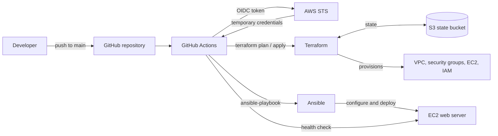
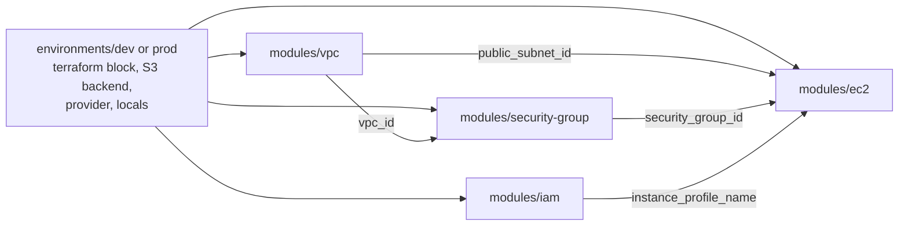

# Architecture

This document describes how the parts of the project fit together. Parts marked **planned** are not built yet.

## Overview

The authentication path (GitHub Actions → STS), the state bucket and the Terraform code for the infrastructure (dev and prod) exist today. Ansible and the health check are still the target design.

## Stages

| Stage | Directory | Tool | Status |
|---|---|---|---|
| 01 State bucket | `bootstrap/01-state-bucket/` | AWS CLI (Bash) | Done |
| 02 GitHub OIDC | `bootstrap/02-github-oidc/` | Terraform, local state | Done |
| 03 Infrastructure | `infrastructure/` | Terraform, S3 backend | In progress: modules and dev/prod environments written, CI permissions for security groups, IAM and EC2 still missing |
| 04 Configuration and deployment | `configuration/`, `application/` | Ansible | Planned |
| 05 Verification | `scripts/` | Bash | Planned |

## Bootstrap Layer

The bootstrap stages solve two chicken-and-egg problems:

- **State bucket:** Terraform cannot store state in a bucket that does not exist yet, so the bucket is created with the AWS CLI instead of Terraform.
- **OIDC role:** GitHub Actions cannot authenticate to AWS until the OIDC provider and role exist, so this stage is applied from a local machine with local Terraform state.

Both stages run once per AWS account and rarely change after that.

## Authentication

GitHub Actions never stores long-lived AWS access keys.

1. The workflow requests an OIDC token from GitHub.
2. It calls `sts:AssumeRoleWithWebIdentity` for `github-actions-terraform-role`.
3. AWS checks the trust policy: the audience must be `sts.amazonaws.com` and the subject must be the `main` branch of this repository.
4. STS returns temporary credentials for the workflow run.

The role can read and write the Terraform state bucket and manage the VPC, subnet, internet gateway and route table in this account and region. It can't manage security groups, IAM roles or EC2 instances yet, so the `deploy` job stops at `terraform plan` for dev until those permissions are added.

## Account-Specific Values

The AWS account ID and the GitHub owner and repository IDs are not committed:

| Where | How |
|---|---|
| Local machine | `TF_VAR_*` variables in the git-ignored `.env` file (template: `.env.example`) |
| GitHub Actions | Repository secrets `AWS_ROLE_ARN` and `AWS_ACCOUNT_ID`, masked in logs |

The OIDC bootstrap and both environments set `allowed_account_ids`, so they stop with an error if the credentials belong to a different account.

Details: [GitHub Actions OIDC Setup](02-github-actions-oidc.md)

## Terraform State

| Configuration | Backend | Location |
|---|---|---|
| `bootstrap/02-github-oidc/` | Local | `terraform.tfstate` on the machine that ran `apply` (git-ignored) |
| `infrastructure/environments/dev/` | S3, native lock file | `s3://shinn-terraform-state-foundation/environments/dev/terraform.tfstate` |
| `infrastructure/environments/prod/` | S3, native lock file | `s3://shinn-terraform-state-foundation/environments/prod/terraform.tfstate` |

The state bucket has versioning, SSE-S3 encryption, blocked public access and lifecycle cleanup.

Details: [S3 Terraform State Bucket Bootstrap](01-s3-state-bucket-bootstrap.md)

## Infrastructure

`infrastructure/modules/` holds reusable modules with only resources, variables and outputs:

- `vpc`: a VPC, one public subnet, an internet gateway and a public route table
- `security-group`: the web server security group (HTTP and HTTPS in, HTTP and HTTPS out)
- `iam`: the EC2 role with `AmazonSSMManagedInstanceCore`, and its instance profile
- `ec2`: the Amazon Linux 2023 web server (IMDSv2, encrypted disk, no SSH key)

`infrastructure/environments/dev/` and `prod/` are the only places Terraform runs. Each one holds the `terraform` block with the S3 backend, the AWS provider with `default_tags`, and the locals, and calls all four modules. dev uses `10.20.0.0/16`, prod uses `10.30.0.0/16`. GitHub Actions applies dev on every push to `main`, and prod only on a manual run.

## Configuration and Deployment (Planned)

- `configuration/inventories/aws_ec2.yml`: an Ansible dynamic inventory that discovers EC2 instances from AWS.
- `configuration/playbooks/deploy-website.yml`: applies the `webserver` role.
- `configuration/roles/webserver/`: installs the web server and deploys the static site in `application/website/`.

AWS Systems Manager will be used where possible, so no SSH keys need to be managed.

## Verification (Planned)

`scripts/health-check.sh` will confirm that the website is reachable and responding correctly after each deployment.
